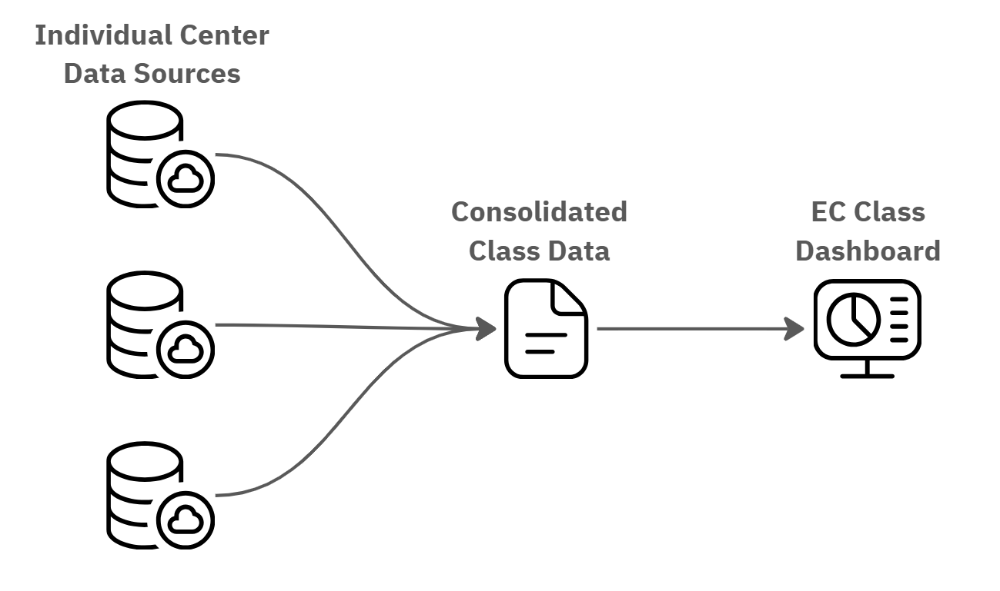
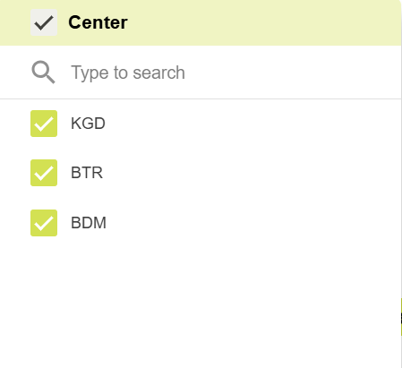
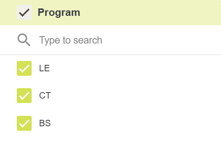
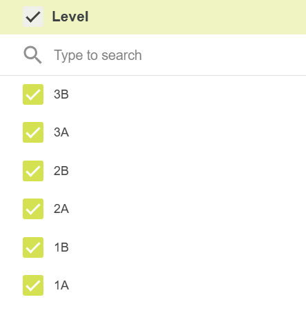
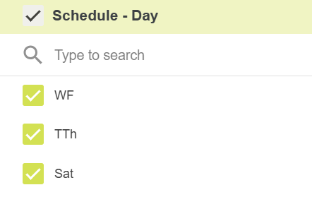
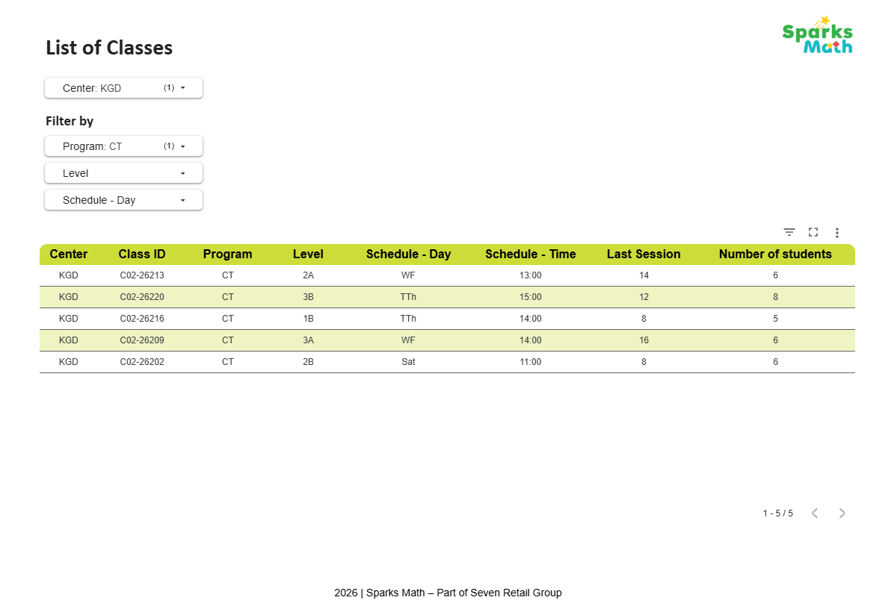

# Class Availability Dashboard for Education Services

An interactive dashboard developed to improve class availability visibility and support enrollment coordination across **10 learning centers**.

🔗 **[View Dashboard](https://datastudio.google.com/reporting/676a69e2-f053-4169-ae9c-2f8f21f4d0fe)**

## Tools & Technologies

- **Looker Studio:** Interactive dashboard development and data visualization.
- **Google Sheets:** Data preparation, consolidation, and dashboard data source.

## Data Source

📁 **[View Google Sheets Data Structure](https://docs.google.com/spreadsheets/d/1ZBLITl_bgqUHjChUdfXcbY1jskI3ij1LxauKjEMfjKQ/edit?gid=844004962#gid=844004962)**

The Google Sheets link provides a reference to the spreadsheet structure and data organization used as the dashboard's data source.

## 1. Problem

Education Consultants (ECs) needed to identify suitable class options for prospective students based on class availability, capacity, and demand across multiple learning centers.

However, class information was maintained separately across centers, making it difficult for ECs to access and compare available options in one place. This limited visibility created challenges when responding to prospective students' inquiries and coordinating class enrollment.

There was an opportunity to centralize class information and make it easier for ECs to identify suitable classes based on students' preferences.

## 2. Solution

Developed an interactive **Class Availability Dashboard** using **Looker Studio**, with **Google Sheets** as the data source.

Since the company's existing infrastructure was built around Google Workspace, Looker Studio was selected to keep the solution within the existing Google ecosystem. This avoided introducing an additional platform and allowed the workflow to remain aligned with the company's established tools.

### Data Integration Workflow

Class availability data from individual learning centers was consolidated into a centralized dataset using Google Sheets. This dataset served as the single data source connected to Looker Studio, providing a unified view of class information across all centers.

The integration workflow enabled ECs to access consolidated class information through one dashboard instead of checking data from separate sources.

### Dashboard Filters

The dashboard provides four interactive filters that allow ECs to explore class availability based on prospective students' preferences:

- **Center:** Filters class information by learning center location.
- **Program:** Allows users to select a specific learning program.
- **Level:** Filters available classes by their respective program levels.
- **Schedule – Day:** Displays class availability based on the scheduled day.

By combining these filters, ECs can narrow down available class options and identify classes that better match prospective students' requirements.

| **1. Center** | **2. Program** |
|:---:|:---:|
|  |  |
| **3. Level** | **4. Schedule – Day** |
|  |  |

## 3. Result

The dashboard provided a centralized view of class availability across **10 learning centers**, supporting **12 Education Consultants** in accessing and exploring relevant class information.

By consolidating previously distributed data and providing interactive filters, the dashboard made it easier for ECs to identify suitable class options based on location, program, level, and schedule. This supported class selection and enrollment coordination with prospective students.

## 4. Dashboard Preview

The following screenshot shows the overall dashboard interface and its class availability overview.

## Dataset

The dataset included in this repository consists of **synthetic data**, created solely to demonstrate the dashboard's structure, data integration workflow, and functionality. It does not contain actual operational or student data.
