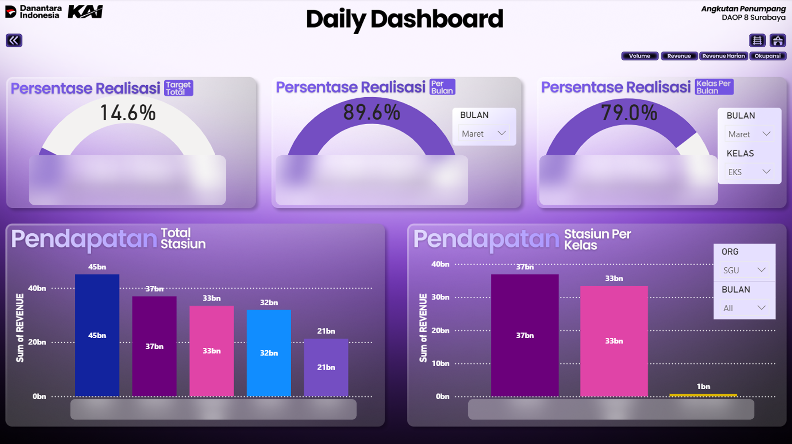
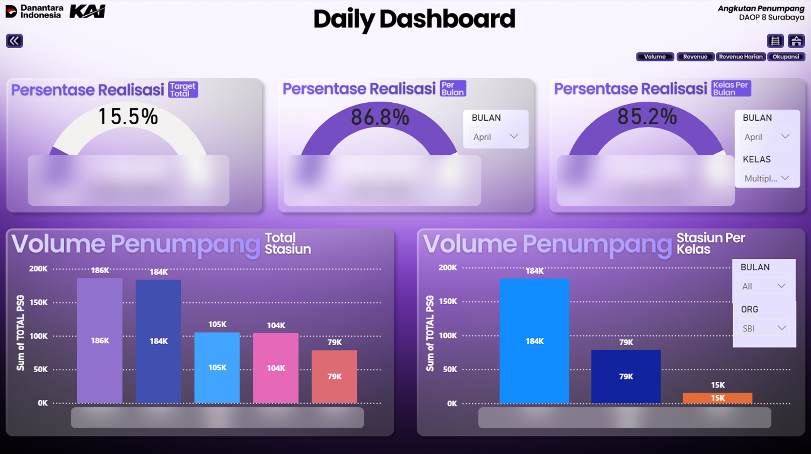
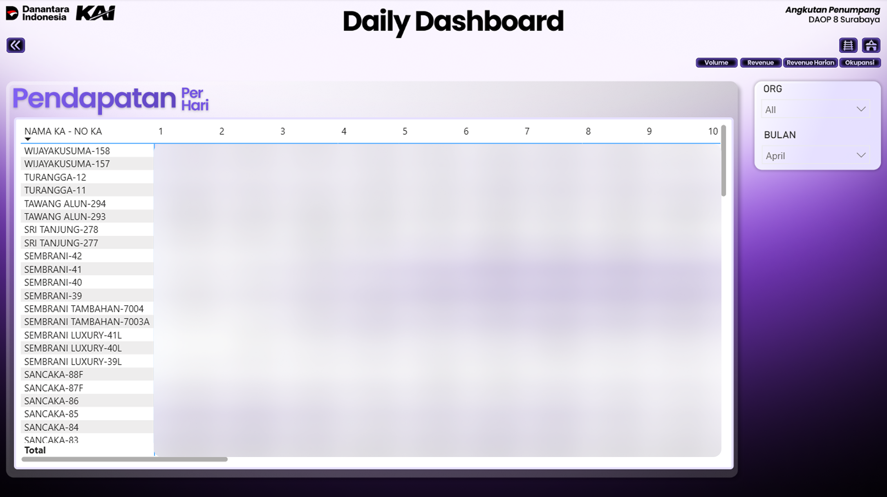
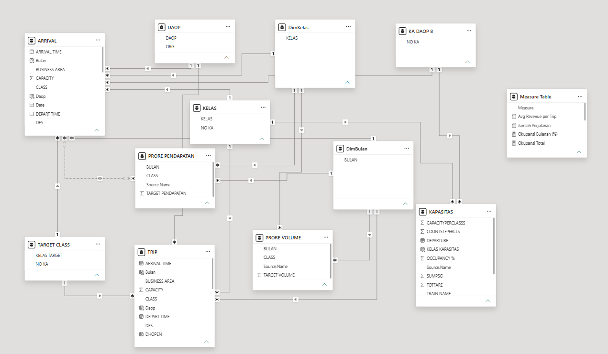

# Passenger Revenue & Volume Monitoring Dashboard

A Power BI dashboard developed during my Data Analyst Internship at **PT Kereta Api Indonesia (Persero) – Passenger Transportation Unit, DAOP 8 Surabaya**, to support operational performance monitoring through revenue, passenger volume, and occupancy insights.

## Tools & Technologies

- **Power BI:** Dashboard development, data modeling, and interactive reporting.
- **Microsoft Excel:** Data preparation and source data management.

## 1. Background & Business Problem

Monitoring passenger transportation performance involves tracking multiple operational and financial indicators, including revenue realization, passenger volume, and train occupancy across stations, train services, and service classes.

However, working with large operational datasets and relying on conventional reporting processes could make it challenging to access and monitor performance information efficiently. The available data needed to be organized into a more accessible reporting format to support routine monitoring and performance evaluation.

This created an opportunity to develop an interactive dashboard that consolidates key performance indicators and provides a more structured view of passenger transportation performance.

## 2. Solution

Developed an interactive **Power BI Dashboard** to consolidate passenger transportation data and provide insights into revenue performance, passenger volume, daily revenue, and train occupancy.

The dashboard was designed to help users monitor performance against established targets, compare contributions across stations and service classes, and explore operational trends through interactive filters.

### Dashboard Overview

The report consists of five pages, covering different aspects of passenger transportation performance. The following sections highlight three key pages.

#### 1. Revenue Performance

Provides an overview of revenue realization against established targets, both in total and by month and service class.

Key insights include:
- **Revenue Target Achievement:** Monitors actual revenue realization against overall targets.
- **Monthly Revenue Performance:** Tracks monthly revenue realization and its progress toward the target.
- **Class-Level Revenue Achievement:** Compares revenue realization across train service classes.
- **Station Revenue Contribution:** Highlights revenue distribution across stations and service classes.

This view helps users monitor revenue performance, identify differences in station contributions, and evaluate progress toward revenue targets.

#### 2. Passenger Volume Performance

Provides an overview of passenger volume realization against targets and highlights passenger distribution across stations and service classes.

Key insights include:
- **Passenger Volume Achievement:** Compares actual passenger volume against the overall target.
- **Monthly Passenger Performance:** Tracks passenger volume realization by month.
- **Class-Level Volume Achievement:** Monitors passenger volume performance across service classes.
- **Station Passenger Distribution:** Compares passenger volume contributions across stations and service classes.

This view supports the evaluation of passenger demand and helps identify differences in passenger distribution across the DAOP 8 service network.

#### 3. Daily Revenue Monitoring

Provides a more detailed view of revenue generated by individual train services across different operating dates.

The report presents daily revenue figures in a matrix format, allowing users to:
- Compare revenue generated by different train services.
- Monitor daily revenue fluctuations across operating dates.
- Identify variations in revenue contribution between train services.
- Filter performance by organization and month for more focused monitoring.

This view helps users move beyond aggregated revenue figures and examine daily performance at the train-service level.

### Additional Dashboard Pages

The complete Power BI report consists of five pages. In addition to the three pages presented above, the report includes further views for train occupancy monitoring and other performance breakdowns.

The complete Power BI report (`.pbix`) is available for further exploration through the link below.

📂 **[Access the Full Power BI Dashboard](https://drive.google.com/file/d/1uqCDWAUBUpNRpcKd97w_VE-rfU-bb7bK/view?usp=sharing)**

### Data Model

The dashboard uses a relational data model to connect operational records with supporting reference tables, including train services, service classes, organizational units, and monthly targets.

This structure allows different report pages to present related performance indicators consistently and supports interactive filtering across the dashboard.

## 3. Result & Business Value

The dashboard transformed large operational datasets into a more accessible and structured performance monitoring tool.

It provided the Passenger Transportation Unit with:
- **Centralized Performance Visibility:** Consolidated revenue, passenger volume, and occupancy indicators in an interactive report.
- **Target Monitoring:** Enabled users to track revenue and passenger volume realization against established targets.
- **Comparative Performance Analysis:** Supported comparisons across stations, train services, and service classes.
- **Daily Performance Tracking:** Provided more detailed visibility into revenue generated by individual train services across operating dates.

By bringing these indicators into one reporting environment, the dashboard supported routine performance monitoring and provided a more accessible basis for operational evaluation and decision-making.
